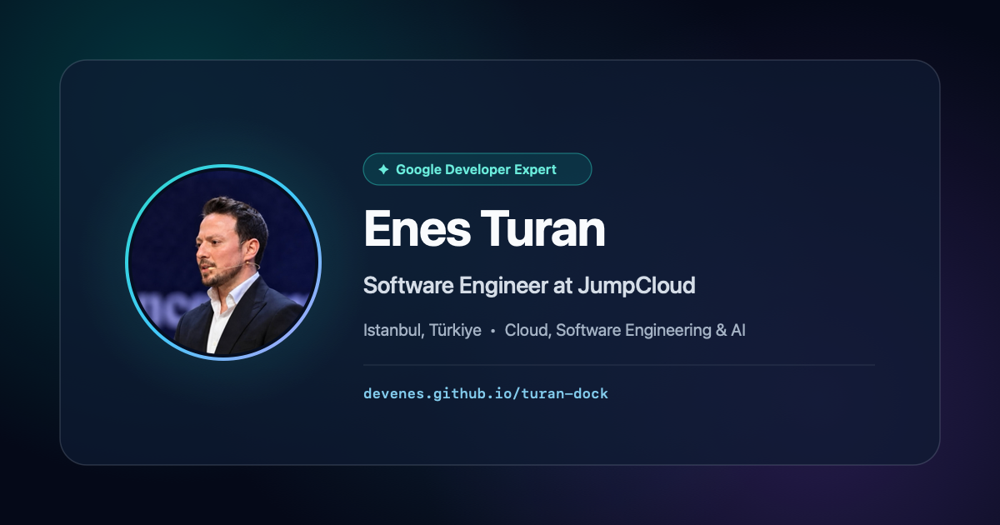

# Turan Dock — Personal Link in Bio

A lightweight, accessible, zero-dependency personal landing page built with the **Midnight Aurora** visual aesthetic.

Designed as a fast, open-source personal brand hub for sharing professional credentials, social profiles, and custom links — hosted for free on GitHub Pages with no build step, frameworks, or tracking.



## Main Features

- **Single-File Configuration**: Customize profile details, badges, contact actions, social accounts, custom links, ordering, and footer attribution solely in `config/profile.js`.
- **Midnight Aurora Design**: Deep obsidian-navy canvas with subtle ambient gradient orbs, tactile noise anti-banding grain, animated avatar gradient ring, and dark-glass link cards.
- **Conference & Networking Actions**:
  - **QR Code & Share Modal (`<dialog>`)**: Zero-dependency ISO/IEC 18004 SVG QR code generator with light-dismiss, Web Share API (`navigator.share`), one-click link copy, and standalone SVG export.
  - **Save Contact (`vCard / .vcf`)**: Dynamically generated RFC-compliant `.vcf` contact card with name, role, organization, email, location, and labeled social profiles.
  - **Anti-Spam Email Copy**: Split `{ user, domain }` email configuration copied directly to clipboard with an accessible top-layer toast notification — zero raw `mailto:` exposure in static HTML.
- **SEO, Structured Data & AI Discoverability**: Built-in `Schema.org` (`ProfilePage` + `Person` with `sameAs`), `llms.txt` summary, `sitemap.xml`, `robots.txt`, and pre-rendered No-JS static HTML fallbacks synced via `node scripts/sync-static.mjs`.
- **Zero Dependencies & Zero Build Step**: Pure HTML5, CSS3, and Vanilla JavaScript ES modules — no bundlers, npm packages, external fonts, or icon CDNs.
- **Privacy-First Cookieless Analytics**: Zero cookies, zero consent banners, and optional privacy-preserving pageview & card-click telemetry via Umami Cloud (`config/profile.js`).
- **Accessible by Default (WCAG 2.2 AA)**: Semantic landmarks (`<main>`, `<nav>`, `<footer>`), native anchor navigation, high-contrast `:focus-visible` outlines, OS dynamic text-scale support (`<meta name="text-scale" content="scale">`), `prefers-reduced-motion` support, and Windows High Contrast (`forced-colors`) fallbacks.
- **Safe Rendering**: Strict DOM construction via `textContent` (no `innerHTML`), strict `https:` URL validation, automatic `rel="noopener noreferrer"`, Content Security Policy enforcement, and automatic SVG icon fallback (`globe.svg`).
- **GitHub Pages Ready**: Strictly relative asset paths (`./assets/...`) and `.nojekyll` support both root domains and `/<repo-name>/` project subpaths out of the box.

## Technology Stack

| Component | Technology |
|---|---|
| Markup | Semantic HTML5 |
| Styling | Modern CSS3 (Custom Properties, Flexbox/Grid, `clamp()`, `100dvh`, `@media` queries) |
| Logic | Vanilla JavaScript (ES Modules) |
| Configuration | `config/profile.js` |
| Icons & Media | Local SVG icons & optimized WebP portrait |
| Typography | Native OS system font stack |
| Hosting | GitHub Pages |

## Repository Structure

```text
turan-dock/
├── index.html                  # Semantic HTML shell, CSP, JSON-LD, SEO & No-JS fallback links
├── llms.txt                    # Machine-readable Markdown summary for AI assistants
├── sitemap.xml                 # XML Sitemap for search crawlers
├── robots.txt                  # Crawler directives & sitemap reference
├── favicon.svg                 # Local vector monogram favicon
├── README.md                   # Documentation & customization guide
├── LICENSE                     # MIT License
├── .nojekyll                   # Bypasses Jekyll processing on GitHub Pages
├── config/
│   └── profile.js              # Single source of truth for profile, contact & links
├── scripts/
│   └── sync-static.mjs         # Optional zero-dep sync script for static HTML/JSON-LD/llms.txt
└── assets/
    ├── css/
    │   └── style.css           # Midnight Aurora design system, modal & toast styles
    ├── js/
    │   ├── main.js             # Safe DOM renderer, URL validator, vCard, copy & modal logic
    │   └── qrcode.js           # Zero-dependency ISO/IEC 18004 QR Code SVG encoder
    ├── images/
    │   ├── profile.webp        # Optimized circular profile photograph
    │   └── og-image.png        # 1200×630 Open Graph / social preview card
    └── icons/
        ├── linkedin.svg
        ├── github.svg
        ├── x.svg
        ├── instagram.svg
        ├── facebook.svg
        ├── youtube.svg
        ├── external-link.svg   # Right-hand directional arrow on link cards
        ├── globe.svg           # Default/fallback icon for custom links
        ├── map-pin.svg         # Location pin icon
        └── sparkle.svg         # Credential badge accent icon
```

## Local Development

Because browsers enforce CORS restrictions on JavaScript ES modules (`type="module"`) over `file://`, serve the directory over a local HTTP server:

```bash
python3 -m http.server 8000
```

Then open [http://localhost:8000](http://localhost:8000) in your browser. Any edit to `config/profile.js`, `index.html`, or `assets/` takes effect immediately on refresh — no build command needed.

## Customization Guide

If you fork this repository for your own personal landing page, almost all changes happen in **`config/profile.js`**.

### 1. Change Profile Information

Open `config/profile.js` and edit the top-level fields:

```javascript
export const profile = {
  name: "Your Name",
  headline: "Your Role at Company",
  badges: [
    {
      label: "Your Credential or Certification",
      icon: "sparkle",
    },
  ],
  location: "City, Country",
  description: "A short one- or two-sentence introduction.",
  // ...
};
```

All optional fields (`headline`, `badges`, `location`, `description`, `footer`) automatically hide cleanly if set to an empty string `""`, empty array `[]`, or `null`.

After editing `config/profile.js`, run `node scripts/sync-static.mjs` to automatically regenerate static `<head>` SEO/Open Graph tags, JSON-LD `ProfilePage` structured data, No-JS HTML link fallbacks, `llms.txt`, and `sitemap.xml`.

### 2. Change the Profile Photograph

1. Export a square (`1:1`, e.g., `400×400` px) `.webp` (recommended for fast loading) or `.jpg`/`.png` portrait and place it in `assets/images/` (for example, `assets/images/profile.webp`).
   ```bash
   # Optional: convert a JPEG/PNG to an optimized 400x400 WebP using cwebp
   cwebp -q 84 -resize 400 400 your-photo.jpg -o assets/images/profile.webp
   ```
2. Update `avatar` in `config/profile.js`:
   ```javascript
   avatar: {
     src: "./assets/images/profile.webp",
     alt: "Descriptive alt text of your portrait",
   },
   ```
   *(A plain string path such as `avatar: "./assets/images/profile.webp"` is also supported.)*

### 3. Add, Reorder, or Remove Social Links

Social buttons render in the exact array order defined in `profile.links` inside `config/profile.js`:

- **Reorder**: Move an object up or down in the `links` array.
- **Remove**: Delete the object from `links` (or disable it — see below).
- **Add**: Append a new entry with a valid `https://` URL and matching icon name from `assets/icons/`:

```javascript
{
  id: "youtube",
  label: "YouTube",
  url: "https://www.youtube.com/@yourhandle",
  icon: "youtube",
  description: "Tech talks, demos & deep dives",
  enabled: true,
}
```

### 4. Add Custom Links (Blog, Talks, Portfolio, Newsletter)

You can add unlimited custom links to `profile.links`:

1. *(Optional)* Drop any `24×24` `.svg` icon into `assets/icons/<my-icon>.svg`. If you omit `icon` or specify `"globe"`, the built-in `assets/icons/globe.svg` icon is used automatically.
2. Add your link object to `profile.links` in `config/profile.js`:

```javascript
{
  id: "blog",
  label: "Engineering Blog",
  url: "https://yourdomain.dev/articles",
  icon: "globe",
  description: "Deep dives on cloud architecture & platform engineering",
  enabled: true,
}
```

> **Security note**: Only valid `https://` URLs are rendered. Unsafe schemes (`javascript:`, `data:`, `http:`) or unconfigured placeholders (`YOUR_...`) are automatically rejected and hidden.

### 5. Disable Links Temporarily

To hide a link without deleting its configuration, set `enabled: false`:

```javascript
{
  id: "youtube",
  label: "YouTube",
  url: "YOUR_YOUTUBE_URL",
  icon: "youtube",
  enabled: false,
}
```

## GitHub Pages Deployment

This project deploys directly from the repository root with zero CI/CD build pipelines required:

1. Push your code to the `main` branch of your public GitHub repository (e.g., `devenes/turan-dock`).
2. On GitHub, navigate to **Settings → Pages**.
3. Under **Build and deployment**:
   - **Source**: Select **Deploy from a branch**.
   - **Branch**: Select **`main`** and folder **`/ (root)`**, then click **Save**.
4. Within ~60 seconds, your site will be live at:
   `https://<your-username>.github.io/<repository-name>/`
   *(For this repository: `https://devenes.github.io/turan-dock/`)*

## License

Released under the [MIT License](./LICENSE). Copyright © 2026 Enes Turan.
